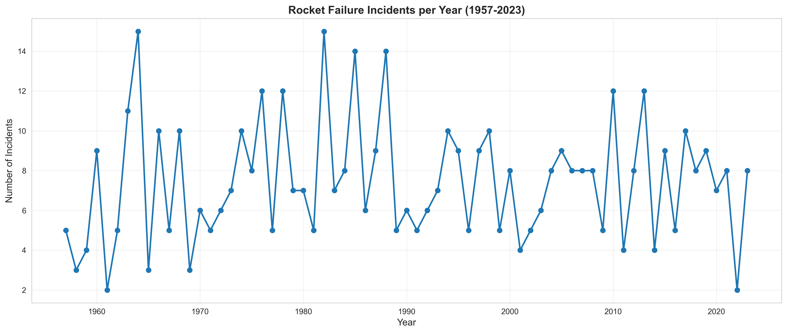
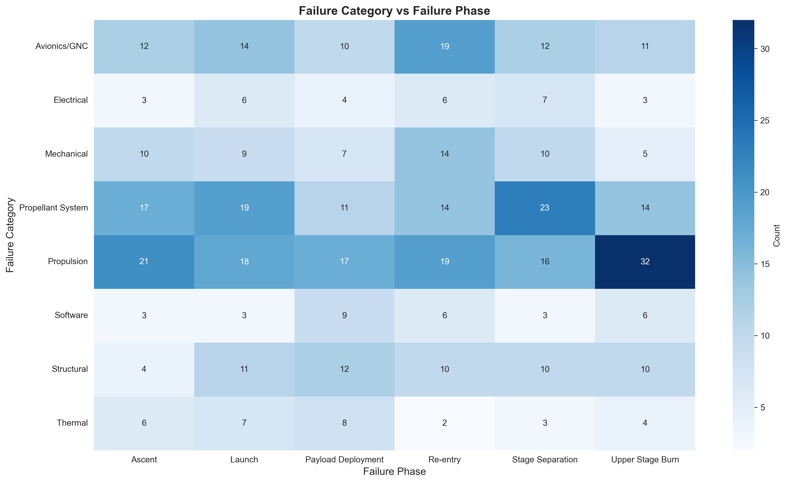
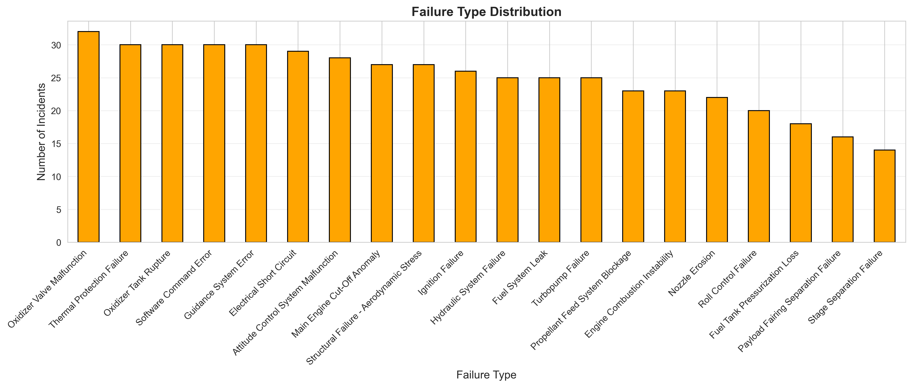
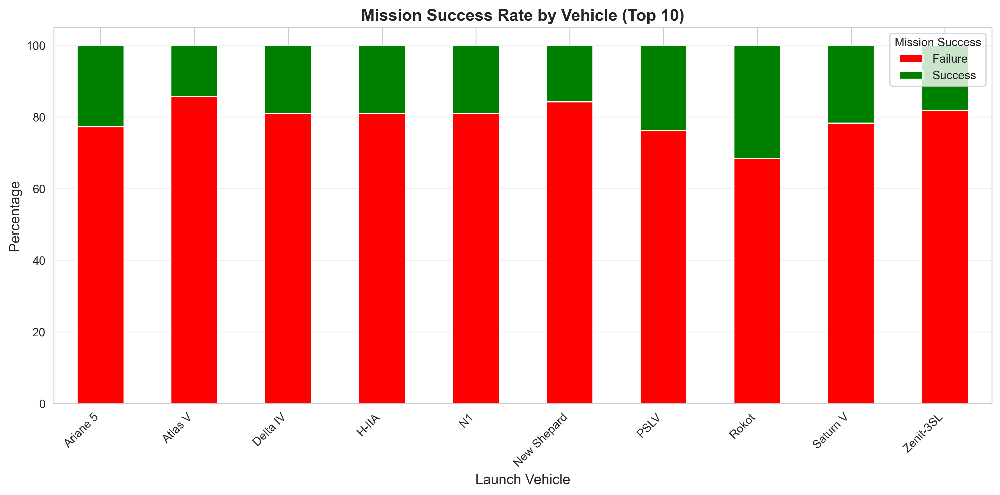

# Rocket Failure QA Chatbot

A retrieval-based question-answering chatbot that answers natural-language questions about rocket launch failure incidents, using classical NLP (NLTK, TF-IDF, BM25 and rules) with no generative models or embeddings.


## Overview

The project answers questions such as "How many failures occurred during ascent?" or "Tell me about incident RFI-0001" over a structured CSV of 500 rocket failure incidents (1957–2023). Every answer is built from templates and cites the retrieved source records, so the output is deterministic and traceable.

Key features (all implemented in `src/`):

- **Text preprocessing** (`src/preprocessor.py`): lowercasing, regex punctuation cleanup, NLTK tokenization, English and domain stop words, a domain synonym dictionary (e.g. `engine` → `propulsion`), Porter stemming (WordNet lemmatization is optional), POS tagging for key-term extraction, and regex named-entity extraction.
- **Rule-based intent classification** (`src/intent_classifier.py`): 7 intents (`COUNT_QUERY`, `STATISTICAL_QUERY`, `FILTER_QUERY`, `FACTUAL_LOOKUP`, `COMPARISON_QUERY`, `TREND_QUERY`, `DEFINITION_QUERY`). Regex patterns are checked in priority order, with a keyword-count fallback. Slot extraction covers vehicle, country, year, decade, failure type, severity, phase, propellant, altitude range and incident ID.
- **Hybrid retrieval** (`src/retrieval_engine.py`): structured pre-filtering on the extracted slots (with fuzzy matching for countries and vehicles), TF-IDF cosine similarity, BM25 (Okapi, k1=1.5, b=0.75), max-normalisation, weighted fusion (0.4 TF-IDF / 0.6 BM25), a minimum-score threshold and top-k ranking (k = 3).
- **Indexing** (`src/feature_engineering.py`): it combines `cause_description`, `notes`, `failure_type` and `failure_category` into one document per incident, then builds the TF-IDF matrix (uni- and bigrams), a BM25 index and an inverted index (built and saved, but not used at query time), and pickles them to `models/`.
- **Template answers** (`src/answer_extractor.py`): one answer template per intent (incident details, filtered lists, counts, comparisons, trends, statistics, definitions).
- **Interfaces**: an interactive CLI (`src/chatbot.py`) and a Streamlit web app (`app/streamlit_app.py`). The web app shows dataset metrics, a top-failure-types chart, decade and severity filters, intent badges, expandable source records and a CSV export of the chat history.
- **Evaluation** (`evaluate.py`): Precision@k, Recall@k, MRR, intent-classification accuracy and response time on a small hand-labelled query set.
- **EDA** (`notebooks/`): data-quality checks plus 24 saved figures covering temporal, vehicle, country, failure-type, numeric and text analysis and a chi-square test.

## Tech stack

| Component | Choice | Why |
|---|---|---|
| Language | Python 3.11 | |
| NLP | NLTK | Tokenization, stop words, stemming/lemmatization and POS tagging without heavy models |
| Lexical retrieval | scikit-learn `TfidfVectorizer`, `rank-bm25` | TF-IDF captures n-gram overlap and BM25 handles term saturation and document length. Fusing the two is more robust than either alone |
| Intent / slots | Python `re` | Deterministic and explainable on a small, closed domain |
| Data | pandas, NumPy | |
| UI | Streamlit | A chat UI with very little code |
| EDA | matplotlib, seaborn, wordcloud, SciPy | Plots and the chi-square test |
| Testing | pytest | |

## Demo / Screenshots

EDA figures from `notebooks/02_eda_analysis.ipynb` (all 24 are in `reports/figures/`):

| Incidents per year | Failure category vs. phase |
|---|---|
|  |  |

| Failure types | Success rate by vehicle |
|---|---|
|  |  |

<!-- TODO: add a screenshot of the Streamlit chat UI at docs/screenshot.png -->


*Owner note: run `streamlit run app/streamlit_app.py`, ask a question such as "How many failures occurred during ascent?", expand "Show source records", and save a screenshot to `docs/screenshot.png`.*

## Dataset

- **Type:** a structured CSV of rocket launch failure incidents (tabular data with free-text cause descriptions).
- **Size:** 500 rows × 18 columns, with dates from 1957-01-10 to 2023-10-06. There are no missing values and no duplicate rows (per `notebooks/01_data_understanding.ipynb`).
- **Columns:** `incident_id` (e.g. `RFI-0001`), `date`, `year`, `month`, `launch_vehicle`, `country`, `launch_site`, `failure_type`, `failure_category`, `failure_phase`, `severity`, `propellant_type`, `altitude_km`, `time_to_failure_sec`, `mission_success`, `cause_description`, `notes`, `decade`.
- **Nature:** the records look templated or synthetic, so treat the dataset as a demo corpus rather than a historical record. [TODO: confirm dataset source and license]
- **Not included in the repo.** Place the file here:

```
rocket-failure-chatbot/
└── data/
    └── rocket_failures.csv
```

**Indexes / model artifacts:** none are included. The `.pkl` files in `models/` (TF-IDF matrix, vectorizer, BM25 index, inverted index, preprocessed documents, metadata) are generated from the CSV:

- `python src/chatbot.py` (CLI) always rebuilds the indexes from the CSV on startup and saves them to `models/`.
- `streamlit run app/streamlit_app.py` and `python evaluate.py` first try to load `models/*.pkl`. If any file is missing, they log a warning, rebuild everything from the CSV and save it.
- If you change the CSV, delete `models/` (or run the CLI once) so the app doesn't load stale indexes.
- `config.py` creates `data/`, `models/` and `reports/figures/` automatically on import.

## Installation

```bash
git clone https://github.com/aliyahseri/rocket-failure-chatbot.git
cd rocket-failure-chatbot

python -m venv .venv
# Windows
.venv\Scripts\activate
# macOS / Linux
source .venv/bin/activate

pip install -r requirements.txt
```

On first import, `src/preprocessor.py` downloads the NLTK resources it needs (`punkt`, `stopwords`, `averaged_perceptron_tagger`, `wordnet`, `omw-1.4`) if they aren't already installed. This step needs internet access once.

## Usage

Run all commands from the repository root after placing `data/rocket_failures.csv`.

```bash
# Interactive CLI (type 'quit' to exit)
python src/chatbot.py

# Streamlit web app
streamlit run app/streamlit_app.py

# Evaluation (prints P@k, R@k, MRR and intent accuracy tables)
python evaluate.py

# Tests (see Known issues: one test module currently fails to import)
python -m pytest tests

# EDA notebooks (run from notebooks/ so the relative config import works)
jupyter notebook notebooks/
```

Example queries:

- "Tell me about incident RFI-0001"
- "Show me all failures in the USSR"
- "How many failures occurred during ascent?"
- "What is the average altitude of failures?"
- "List propulsion failures in the 1980s"
- "What is nozzle erosion?"

## Results

- **EDA:** a chi-square test of `failure_type` vs. `mission_success` gave χ² = 12.47, df = 19, p = 0.864, so there is no significant association (notebook 02).
- **Retrieval / intent metrics:** `evaluate.py` computes them, but no run results are saved in the repo. Its ground-truth lists are also incomplete (see Known issues), so recall figures from it would not be reliable. Run `python evaluate.py` to reproduce.

## Project structure

```
rocket-failure-chatbot/
├── app/
│   └── streamlit_app.py        # Streamlit chat UI
├── data/
│   └── README.md               # where to put rocket_failures.csv (data not included)
├── notebooks/
│   ├── 01_data_understanding.ipynb
│   └── 02_eda_analysis.ipynb
├── reports/figures/            # 24 EDA figures
├── src/
│   ├── data_loader.py          # CSV loading + schema validation
│   ├── preprocessor.py         # NLTK preprocessing pipeline
│   ├── feature_engineering.py  # TF-IDF, BM25, inverted index, pickling
│   ├── intent_classifier.py    # regex intents + slot extraction
│   ├── retrieval_engine.py     # filtering + hybrid scoring
│   ├── answer_extractor.py     # template answers per intent
│   └── chatbot.py              # controller + CLI entry point
├── tests/
│   ├── test_preprocessor.py
│   └── test_retrieval_engine.py
├── config.py                   # paths, hyperparameters, intent patterns, synonyms
├── evaluate.py                 # P@k, R@k, MRR, intent accuracy
└── requirements.txt
```

## Challenges & what I learned

- **Combining structured and unstructured search:** many questions are really filters ("in the 1980s", "USSR"), so slots are applied as a hard pre-filter before ranking free text. This means the lexical scorers have to work on a subset of the corpus, and that is exactly where the BM25 indexing bug below appears.
- **Score fusion:** TF-IDF cosine and BM25 scores sit on different scales, so each is divided by its maximum before the 0.4/0.6 weighted sum.
- **Rule-based intent detection:** overlapping regexes needed an explicit priority order and early exits for definitions ("what is …" vs. "what is the average …"). Broad patterns turned out to be easy to over-trigger.
- **Explainable answers:** template answers with cited incident IDs make every response auditable, at the cost of less fluent language. [TODO: confirm]

## Known issues & limitations

These were found during review and have not been fixed:

1. **BM25 scores misaligned after filtering:** `src/retrieval_engine.py` `compute_bm25_scores` scores the full corpus but pairs `candidate_indices[i]` with `scores[i]` instead of `scores[candidate_indices[i]]`. Any query with a structured filter therefore ranks on the wrong BM25 scores.
2. **"launch" triggers a phase filter:** slot regexes in `src/intent_classifier.py` are compiled with `re.IGNORECASE`, so the ordinary word "launch" sets `failure_phase=Launch` and silently filters results.
3. **Over-broad comparison pattern:** `COMPARISON_QUERY` includes `\b(\w+)\s+and\s+(\w+)\b` (`config.py`), which matches almost any sentence containing "and" that no higher-priority intent caught. "X or Y" comparisons are not handled, and only the first country or vehicle slot is kept, so "USA or USSR" filters to USA only.
4. **Shared Streamlit state:** `app/streamlit_app.py` caches the chatbot with `@st.cache_resource` and the sidebar filters assign `chatbot.df = filtered_df`. Filters therefore mutate an object shared by all sessions. Because `main()` re-reads `df = chatbot.df` on every rerun, switching a filter back to "All" does not restore the full dataset.
5. **Evaluation ground truth:** `evaluate.py` uses short hand-picked `relevant_ids` lists (5–6 IDs) for broad queries such as "Failures in the 1970s", so Recall@k is unreliable. P@5 is reported while retrieval returns at most `top_k = 3` results, so P@5/R@5 equal P@3/R@3.
6. **Notebook cell fails:** `notebooks/02_eda_analysis.ipynb` overwrites `df['month']` with month names, so the later correlation-heatmap cell fails (`ValueError: could not convert string to float: 'January'`) and figure 16 is missing.
7. **Test import error:** `tests/test_retrieval_engine.py` fails at collection under pytest (`ModuleNotFoundError: No module named 'preprocessor'`), because `src/retrieval_engine.py` (like `feature_engineering.py` and `intent_classifier.py`) uses a bare `from preprocessor import ...`. With `src/` on the path, 2 of its tests still fail (`test_fuse_scores` expects a different order; `test_retrieve_full_pipeline` raises `NameError`).
8. **Failing preprocessor tests:** `tests/test_preprocessor.py` has 2 failures. `remove_punctuation` intentionally keeps `.`, `,` and `-`, and "rocket" is a configured domain stop word, both of which contradict the tests' expectations.
9. **Multi-word synonyms never fire:** synonyms are applied per token, so the `"blew up"` entry in `SYNONYM_DICT` never matches.
10. **Fixed vocabularies:** slot vocabularies (vehicles, countries, failure types) are hard-coded regexes. For example, "N1" appears in the data but is not a recognised vehicle slot. Vehicle names are also not part of the indexed text, so "What caused the N1 rocket failure?" cannot target N1 records.
11. **Exact-match slot filters:** the `failure_type` slot "Structural Failure" never equals the data value "Structural Failure - Aerodynamic Stress", so that filter returns 0 records.
12. **NLTK version:** the code downloads `punkt` and `averaged_perceptron_tagger`, which work with the pinned `nltk==3.8.1`. Newer NLTK releases need `punkt_tab` and `averaged_perceptron_tagger_eng` instead.

## Future improvements

- Fix the BM25 index alignment (issue 1) and add a regression test for filtered queries.
- Make slot extraction case-aware and context-aware, support multi-entity comparisons ("X or Y", "X vs Y"), and narrow the comparison regex.
- Keep filters in `st.session_state` instead of mutating the cached chatbot.
- Build complete relevance judgements (e.g. derived from the structured columns) and report P@k only for k ≤ top_k.
- Fix the test imports (package-relative imports or a `conftest.py`), align tests with the intended preprocessing, and add CI.
- Derive slot vocabularies from the dataset instead of hard-coding them.

## Credits / Acknowledgements

- Dataset: rocket failure incidents CSV. [TODO: confirm dataset source, author and license]
- Libraries: [NLTK](https://www.nltk.org/), [scikit-learn](https://scikit-learn.org/), [rank-bm25](https://github.com/dorianbrown/rank_bm25), [Streamlit](https://streamlit.io/), pandas, NumPy, matplotlib, seaborn, wordcloud, SciPy.
- BM25: Robertson & Zaragoza, *The Probabilistic Relevance Framework: BM25 and Beyond* (2009).

## License

MIT, see [LICENSE](LICENSE).

## Author

**Aliyah Seri**

- GitHub: [aliyahseri](https://github.com/aliyahseri)
