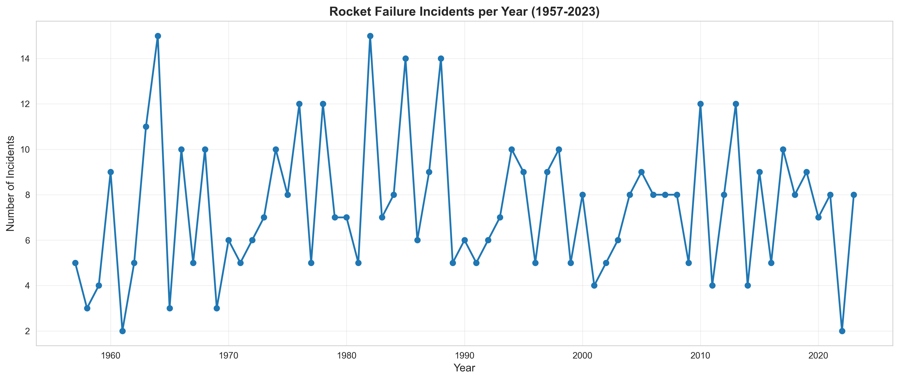
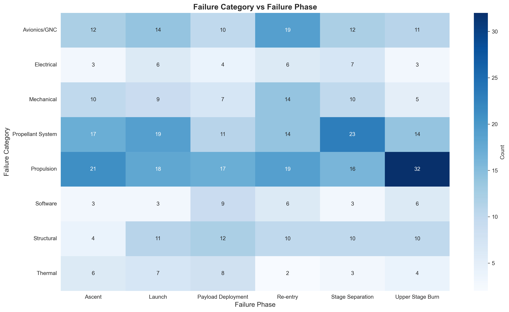

# Rocket Failure Chatbot

## Introduction
This project is a question-answering chatbot about rocket launch failures. It works out what kind of question is being asked, searches a dataset of failure incidents with TF-IDF and BM25 ranking, and answers in plain English. It runs in the terminal or as a Streamlit web app.

## Output
Some of the data analysis behind the chatbot:

## Features
* NLTK text preprocessing (tokenizing, stemming, synonyms)
* Intent classification for 7 question types
* TF-IDF and BM25 search combined
* Streamlit web interface
* Evaluation with Precision@k, Recall@k and MRR

## Usage
* Terminal chatbot: `python src/chatbot.py`
* Web app: `streamlit run app/streamlit_app.py`
* Evaluation: `python evaluate.py`
* Example questions: "Show me all failures in the USSR", "How many failures occurred during ascent?"

## Dataset
A CSV of 500 rocket failure incidents (1957–2023), placed at `data/rocket_failures.csv`.

## Requirements
* python 3.10+
* nltk
* scikit-learn
* rank-bm25
* pandas
* streamlit
